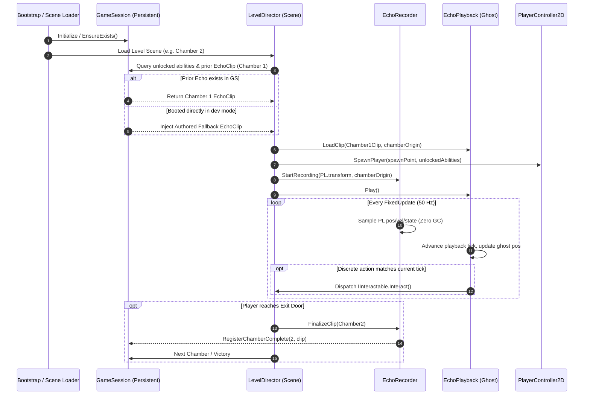

# Core Systems Architecture Specification
**GLITCHVERSE: ECHO PROTOCOL**
*Project Owner / Core Systems Engineer: Shlok (Antigravity)*
*Branch: `feature/shlok-core`*
*Status: Proposal ready for Lead Review*

---

## 1. Executive Summary & System Boundaries

GLITCHVERSE: ECHO PROTOCOL is a cinematic 2.5D puzzle-platformer built on Unity 6 Universal 2D. The core mechanical hook relies on **Echoes**—temporal recordings of player trajectories and discrete puzzle interactions executed in prior chambers that replay as interactive elements in subsequent chambers.

### System Boundaries & Code Ownership (per `docs/INTERFACES.md`)
- **Shlok (Core Systems & Integration):**
  - Core lifecycle: `Assets/_Game/Scripts/Core/` (`GameSession`, `LevelDirector`, contracts, shared events).
  - Echo systems: `Assets/_Game/Scripts/Echo/` (`EchoRecorder`, `EchoPlayback`, recording data structures, interpolation, synthetic fallbacks).
  - Scenes & Integration: `Assets/_Game/Scenes/Bootstrap.unity`, Build settings, and architectural contract enforcement.
- **Lalit (Player & Mechanics):**
  - `Assets/_Game/Scripts/Player/` (`PlayerController2D`, input handling).
  - `Assets/_Game/Scripts/Mechanics/` (`AbilityController`, gravity invert, time freeze, dimension swap).
  - `Assets/_Game/Prefabs/Player/`.
- **Soham (Levels, Art, UI):**
  - `Assets/_Game/Scenes/Levels/` (Chambers 1–4).
  - `Assets/_Game/Art/`, `Assets/_Game/Audio/`, `Assets/_Game/UI/`.
- **ChatGPT (Technical Lead):**
  - Review of architecture contracts, acceptance tests, merge gatekeeper.

---

## 2. File Plan

```text
BOSSFIGHT-/
├── docs/
│   ├── CORE_ARCHITECTURE.md              <-- This specification
│   ├── INTERFACES.md                     <-- Master contract definition
│   ├── PRODUCTION_PLAN.md                <-- Schedule & milestone gates
│   └── TEAM_PROMPTS.md                   <-- Teammate instructions
└── Assets/                               <-- Created upon Unity 6 baseline bootstrap
    └── _Game/
        ├── Scenes/
        │   └── Bootstrap.unity           <-- [Shlok] Persistent boot scene
        └── Scripts/
            ├── Core/
            │   ├── IGameSession.cs       <-- [Shlok] Session public contract
            │   ├── ILevelDirector.cs     <-- [Shlok] Level director contract
            │   ├── IInteractable.cs      <-- [Shlok/Shared] World interaction contract
            │   ├── GameSession.cs        <-- [Shlok] Persistent singleton implementation
            │   ├── LevelDirector.cs      <-- [Shlok] Scene orchestrator implementation
            │   ├── ChamberData.cs        <-- [Shlok] Enums, chamber definitions, ability flags
            │   └── CoreEvents.cs         <-- [Shlok] Typed action delegates & event structs
            └── Echo/
                ├── IEchoRecorder.cs      <-- [Shlok] Recorder public contract
                ├── IEchoPlayback.cs      <-- [Shlok] Playback public contract
                ├── EchoTypes.cs          <-- [Shlok] EchoSample, EchoActionEvent, EchoClip
                ├── EchoRecorder.cs       <-- [Shlok] FixedUpdate sample capture
                ├── EchoPlayback.cs       <-- [Shlok] Kinematic ghost playback & trigger dispatch
                ├── EchoGhostVisual.cs    <-- [Shlok] Ghost visual trail & shader parameter driver
                └── EchoFallbackData.cs   <-- [Shlok] Authored fallback clips for isolated scene testing
```

---

## 3. Data Structures & Recording Sample Format

### 3.1 Kinematic Sample Layout (`EchoSample`)
To guarantee zero-allocation recording at runtime and minimal memory footprint, the kinematic sample is a fixed-size, sequential value type packed to 24 bytes:

```csharp
using System;
using System.Runtime.InteropServices;
using UnityEngine;

namespace GlitchVerse.Echo
{
    [Serializable]
    [StructLayout(LayoutKind.Sequential, Pack = 1)]
    public struct EchoSample
    {
        public uint tick;             // 4 bytes: simulation tick count from room start
        public Vector2 position;      // 8 bytes: room-relative (x, y) coordinates
        public Vector2 velocity;      // 8 bytes: (vx, vy) for animation blending & predictive audio
        public sbyte facingDirection; // 1 byte:  +1 for Right, -1 for Left
        public byte movementFlags;    // 1 byte:  bitmask: [0]=Grounded, [1]=Jumping, [2]=InvertedGravity, [3]=TimeFrozen, [4]=DimensionB
        public ushort customState;    // 2 bytes: auxiliary state for mechanics extension (e.g. animation state ID)
    } // Exact size: 24 bytes per sample
}
```

### 3.2 Discrete Action Events (`EchoActionEvent`)
Continuous sampling captures trajectories, but puzzle mechanics (pressing a switch, firing an ability, toggling a dimension) are sparse discrete impulses. These are recorded as explicit action events tied to exact simulation ticks:

```csharp
namespace GlitchVerse.Echo
{
    [Serializable]
    public enum EchoActionType : byte
    {
        Interact = 0,         // Pressed 'E' on an interactable
        GravityInvert = 1,    // Fired 'G' gravity shift
        TimeFreeze = 2,       // Fired 'F' freeze toggle
        DimensionToggle = 3,  // Fired 'Q' dimension swap
        CustomTrigger = 4     // Level-specific trigger event
    }

    [Serializable]
    [StructLayout(LayoutKind.Sequential, Pack = 1)]
    public struct EchoActionEvent
    {
        public uint tick;                 // 4 bytes: exact simulation tick
        public EchoActionType actionType; // 1 byte: action identifier
        public int targetId;              // 4 bytes: stable instance ID or name hash of IInteractable
        public Vector2 interactionOrigin; // 8 bytes: position where action originated
    } // Exact size: 17 bytes per event
}
```

### 3.3 The Recorded Clip (`EchoClip`)
A bounded container holding recorded samples and discrete actions for a single chamber:

```csharp
namespace GlitchVerse.Echo
{
    [Serializable]
    public class EchoClip
    {
        public int chamberIndex;
        public uint totalTicks;
        public float durationSeconds;
        public Vector2 recordedOrigin; // Chamber origin offset for spatial alignment
        public EchoSample[] samples;
        public EchoActionEvent[] actions;
        public int sampleCount;
        public int actionCount;

        public EchoClip(int maxCapacity = 3000, int maxActions = 128)
        {
            samples = new EchoSample[maxCapacity];
            actions = new EchoActionEvent[maxActions];
            sampleCount = 0;
            actionCount = 0;
        }

        public void Clear()
        {
            sampleCount = 0;
            actionCount = 0;
            totalTicks = 0;
            durationSeconds = 0f;
        }
    }
}
```

### 3.4 Memory & Bandwidth Budget
- **Physics Rate:** 50 Hz (`Time.fixedDeltaTime = 0.02s`).
- **Chamber Time Cap:** 60 seconds per puzzle = $60 \times 50 = 3,000\text{ samples}$.
- **Kinematic Data:** $3,000 \times 24\text{ bytes} = 72,000\text{ bytes } (\approx 70.3\text{ KB})$.
- **Action Data:** $128 \times 17\text{ bytes} = 2,176\text{ bytes } (\approx 2.1\text{ KB})$.
- **Total Memory per Chamber Clip:** $\approx 72.5\text{ KB}$.
- **Four Chambers Total:** $< 300\text{ KB}$ for the entire game session.
- **Garbage Collection (GC):** Zero allocations during recording. Ring/fixed preallocated buffers are reused across runs.

---

## 4. Deterministic Playback Strategy

### 4.1 Fixed Simulation Clock
- Replay does **not** rely on floating-point `Time.time` or frame-varying `Update()`.
- Both `EchoRecorder` and `EchoPlayback` advance on integer simulation ticks driven by `FixedUpdate()`:
  $$\text{currentTick} = \text{round}\left(\frac{\text{chamberElapsedTime}}{\text{fixedDeltaTime}}\right)$$
- If the game slows down or drops frames, simulation ticks remain lock-stepped with Unity's Physics2D pipeline.

### 4.2 Non-Physical Ghost vs. Puzzle Triggers
Per `docs/INTERFACES.md`, the Echo is **not** a fully physical second player:
1. **Collision Avoidance:** The Echo has no dynamic `Rigidbody2D`. It does not push the live player, and the live player cannot stand on or get stuck on the Echo.
2. **Layer Matrix Specification:**
   - Layer `Echo` (e.g., Layer 9).
   - `Echo` $\times$ `Ground`: **Ignore** (Ghost does not collide with solid geometry).
   - `Echo` $\times$ `Player`: **Ignore** in Chambers 1, 2, 4. In Chamber 3 (*The Past Is Your Enemy*), a dedicated trigger collider reports player overlap as a hazard touch.
   - `Echo` $\times$ `Interactive`: **Trigger Overlap Enabled** (allows Ghost to depress pressure plates, break laser beams, and trigger proximity switches).
   - `Echo` $\times$ `Hazard`: **Ignore** (Ghost is unaffected by spikes/lasers unless script-driven).

### 4.3 Rendering Interpolation
To eliminate visual stutter when running on 60 Hz, 120 Hz, or 144 Hz displays while physics runs at 50 Hz:
- In `FixedUpdate()`, the target sample indices `k` and `k + 1` are locked.
- In `Update()`, the Ghost's visual transform is smoothly interpolated using:
  $$\alpha = \frac{\text{Time.time} - \text{lastFixedTime}}{\text{Time.fixedDeltaTime}}$$
  $$\text{RenderPos} = \text{Lerp}(\text{Sample}_k.\text{position}, \text{Sample}_{k+1}.\text{position}, \alpha)$$

### 4.4 Action Event Dispatching
- When `currentTick == actionEvent.tick`:
  - `EchoPlayback` queries the scene for the interactable identified by `targetId` or casts an interaction overlap circle at `actionEvent.interactionOrigin` (radius $0.5\text{ units}$).
  - Invokes `IInteractable.Interact(IInteractionContext context)`.
  - Emits `OnEchoActionExecuted(EchoActionEvent evt)` for audio/visual feedback.

---

## 5. Checkpoint, Re-Record & Anti-Softlock Strategy

### 5.1 The Cross-Chamber Dependency Challenge
- **Chamber 1:** Player solves puzzle and records trajectory.
- **Chamber 2:** Replays Chamber 1's Echo to activate Switch B while the player navigates inverted gravity.
- **Chamber 3:** Replays Chamber 2's or combined Echo as a moving temporal hazard/partner.
- **Chamber 4:** Finale combining Echoes and dimension switching.

### 5.2 Failure & Re-Record Flows
1. **In-Chamber Death or Quick Reset (`R` key):**
   - Player restarts at Chamber Spawn Point.
   - Puzzle switches and movable props reset.
   - Echo playback restarts at Tick 0.
   - **Crucial Rule:** The previously recorded valid `EchoClip` for prior chambers is **never** destroyed by a death or reset in the current chamber.
2. **Voluntary Re-Record (Anti-Frustration):**
   - If the player's Chamber 1 recording was suboptimal (e.g., 40 seconds of waiting before pushing the box), the player can choose "Re-record Prior Echo" from the pause menu or interact with an *Echo Terminal* at the chamber entrance.
   - This reloads Chamber 1 in "Record Mode" with the option to accept or discard the new recording.
3. **Leading Idle Trimming:**
   - `EchoRecorder` detects stationary idle frames at the start of a chamber. When saving the clip, it discards leading idle ticks prior to the first movement input or interaction, guaranteeing instant playback response in subsequent chambers.
4. **Authored Fallback Echoes (`EchoFallbackData`):**
   - When Soham or Lalit boots `Level02.unity` or `Level03.unity` directly in the Unity Editor (bypassing `Bootstrap` and Chamber 1), `GameSession` detects `GetEchoClip(priorChamber) == null`.
   - Instead of throwing null reference exceptions or soft-locking the puzzle, `GameSession` automatically injects a verified, authored fallback `EchoClip` that pushes the cube / steps on the plate at the exact intended timing.

---

## 6. Error Recovery & Edge Cases

| Edge Case | Risk | Mitigation Architecture |
|---|---|---|
| **Interactable Desynchronization** | Echo attempts to interact with an object that was moved or destroyed. | `EchoPlayback` uses a defensive overlap sweep. If `targetId` is invalid or unreachable, it logs a warning, triggers a visual "Glitch Flutter" effect, and skips the action without halting playback. |
| **Direct Scene Boot (No Bootstrap)** | Team members boot directly into `Level03.unity`. | Auto-instantiation: `GameSession.EnsureExists()` runs before any scene `LevelDirector.Awake()`. Default ability unlocks and fallback echoes are injected automatically. |
| **Recording Buffer Overflow** | Player stalls in a room beyond 60 seconds (3,000 samples). | `EchoRecorder` transitions from record mode to a bounded ring-buffer or gracefully stops recording at tick 3,000, displaying a warning HUD indicator ("ECHO BUFFER SATURATED"). |
| **Physics / Collision Divergence** | Minor sub-tick physics divergence causes a pushed cube to drift 0.1 units. | Pressure plates and interactables use tolerant trigger volumes (e.g. padding of $+0.2\text{ units}$) and trigger locking. Echo interaction points are evaluated spatially with tolerance. |
| **Scene Reload Duplication** | Reloading a scene creates duplicate `GameSession` singletons. | Strict singleton self-destruction in `GameSession.Awake()`: `if (Instance != null && Instance != this) { Destroy(gameObject); return; } DontDestroyOnLoad(gameObject);`. |

---

## 7. C# Public Contracts & Interfaces

### 7.1 `IGameSession.cs`
```csharp
using System;
using GlitchVerse.Echo;

namespace GlitchVerse.Core
{
    public interface IGameSession
    {
        int CurrentChamberIndex { get; }
        float TotalPlayTime { get; }
        int ResetCount { get; }
        AbilityFlags UnlockedAbilities { get; }

        event Action<int> OnChamberChanged;
        event Action<AbilityFlags> OnAbilityUnlocked;
        event Action<int, EchoClip> OnEchoSaved;

        void RegisterChamberComplete(int chamberIndex, EchoClip recordedClip);
        void UnlockAbility(AbilityFlags ability);
        bool HasAbility(AbilityFlags ability);
        EchoClip GetEchoClip(int chamberIndex);
        void SetEchoClip(int chamberIndex, EchoClip clip);
        void ResetSession();
        void RestartCurrentChamber();
    }
}
```

### 7.2 `ILevelDirector.cs`
```csharp
using System;
using GlitchVerse.Echo;
using UnityEngine;

namespace GlitchVerse.Core
{
    public enum LevelState
    {
        Initializing,
        Ready,
        Running,
        Paused,
        Completed,
        Failed
    }

    public interface ILevelDirector
    {
        int ChamberIndex { get; }
        LevelState CurrentState { get; }
        Transform PlayerSpawnPoint { get; }
        Vector2 ChamberOrigin { get; }
        uint CurrentSimulationTick { get; }

        event Action<LevelState> OnStateChanged;
        event Action OnLevelStarted;
        event Action OnLevelCompleted;
        event Action<string> OnPlayerDied;
        event Action OnLevelReset;

        void StartLevel();
        void CompleteLevel();
        void FailLevel(string cause);
        void RestartLevel();
        void RegisterInteractable(IInteractable interactable);
        void UnregisterInteractable(IInteractable interactable);
    }
}
```

### 7.3 `IInteractable.cs`
```csharp
using UnityEngine;

namespace GlitchVerse.Core
{
    public interface IInteractionContext
    {
        GameObject SourceActor { get; }
        bool IsEcho { get; }
        Vector2 InteractionPoint { get; }
    }

    public interface IInteractable
    {
        int InteractableId { get; }
        bool IsActive { get; }
        bool CanInteract(IInteractionContext context);
        void Interact(IInteractionContext context);
    }
}
```

### 7.4 `IEchoRecorder.cs`
```csharp
using System;
using UnityEngine;

namespace GlitchVerse.Echo
{
    public interface IEchoRecorder
    {
        bool IsRecording { get; }
        uint RecordedTicks { get; }
        int SampleCapacity { get; }

        event Action OnRecordingStarted;
        event Action<EchoClip> OnRecordingStopped;
        event Action OnBufferSaturated;

        void StartRecording(Transform actorToTrack, Vector2 roomOrigin);
        void StopRecording();
        void DiscardRecording();
        void RecordActionEvent(EchoActionType actionType, int targetId, Vector2 origin);
        EchoClip FinalizeClip(int chamberIndex);
    }
}
```

### 7.5 `IEchoPlayback.cs`
```csharp
using System;
using UnityEngine;

namespace GlitchVerse.Echo
{
    public enum PlaybackMode
    {
        Loop,
        PlayOnceAndHold,
        PlayOnceAndDeactivate
    }

    public interface IEchoPlayback
    {
        bool IsPlaying { get; }
        uint CurrentPlaybackTick { get; }
        PlaybackMode Mode { get; set; }
        EchoClip LoadedClip { get; }

        event Action OnPlaybackStarted;
        event Action OnPlaybackFinished;
        event Action<EchoActionEvent> OnActionDispatched;

        void LoadClip(EchoClip clip, Vector2 targetRoomOrigin);
        void Play();
        void Pause();
        void Stop();
        void ResetToBeginning();
        void SeekToTick(uint tick);
    }
}
```

### 7.6 `ChamberData.cs`
```csharp
using System;

namespace GlitchVerse.Core
{
    [Flags]
    public enum AbilityFlags : byte
    {
        None = 0,
        GravityInvert = 1 << 0,
        TimeFreeze = 1 << 1,
        DimensionSwap = 1 << 2,
        All = GravityInvert | TimeFreeze | DimensionSwap
    }

    public static class ChamberConstants
    {
        public const int Chamber1_TheFirstLie = 1;
        public const int Chamber2_GravitySuggestion = 2;
        public const int Chamber3_PastIsEnemy = 3;
        public const int Chamber4_BreakTheSystem = 4;

        public const float FixedSimulationDeltaTime = 0.02f; // 50 Hz
        public const int MaxSamplesPerChamber = 3000;         // 60 seconds
        public const int MaxActionsPerChamber = 128;
    }
}
```

---

## 8. Integration Flow & Verification Protocol



---

## 9. Current Status & Next Steps

1. **Workspace Verification:** Confirmed repository is `shlokm123/BOSSFIGHT-` on branch `feature/shlok-core`.
2. **Main Preservation:** `main` branch remains untouched. Unity baseline project is not yet initialized.
3. **Review Gate:** File plan and proposed contracts are submitted for ChatGPT / Tech Lead review.
4. **Execution Gate:** No downstream components depending on other teammates (`PlayerController2D`, `AbilityController`, level scenes) will be constructed until lead approval of these contracts.
5. **Test Status:** No tests have been run as Unity is not yet initialized.
