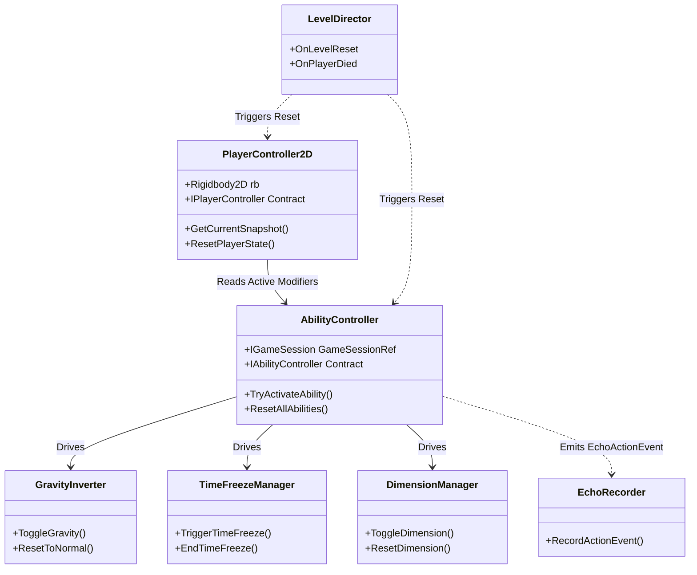

# Gameplay Mechanics Architecture Specification
**GLITCHVERSE: ECHO PROTOCOL**  
*Gameplay Mechanics Engineer: Lalit (Antigravity)*  
*Branch: `feature/lalit-mechanics`*  
*Status: Proposal Ready for Project Lead Review*  

---

## 1. Executive Summary & Workstream Boundaries

GLITCHVERSE: ECHO PROTOCOL requires modular, decoupled, and responsive 2D gameplay components running in Unity 6 Universal 2D. This specification outlines the public interfaces, internal mechanics, error-handling strategies, and test suites for all player and reality-manipulation systems.

### Workstream Ownership (`docs/INTERFACES.md`)
- **Owned by Lalit (`feature/lalit-mechanics`):**
  - `Assets/_Game/Scripts/Player/` (`PlayerController2D`, `PlayerInputHandler`, `PlayerTelemetrySnapshot`).
  - `Assets/_Game/Scripts/Mechanics/` (`AbilityController`, `GravityInverter`, `TimeFreezeManager`, `FreezableObject2D`, `DimensionManager`, `DimensionObject2D`).
  - `Assets/_Game/Prefabs/Player/` (`Player_Prototype.prefab`).
- **Dependencies from Core (Shlok - `feature/shlok-core`):**
  - `GlitchVerse.Core.IGameSession` / `AbilityFlags` (ability unlock validation).
  - `GlitchVerse.Core.ILevelDirector` (level lifecycle, reset notifications, player death).
  - `GlitchVerse.Core.IInteractable` / `IInteractionContext` (puzzle object interaction contract).
  - `GlitchVerse.Echo.EchoSample` / `EchoActionEvent` (telemetry snapshot alignment).
- **Consuming Workstream (Soham - `feature/soham-levels`):**
  - Levels Chambers 1–4 consume `FreezableObject2D` on hazards/crates and `DimensionObject2D` on phase-shifting platforms.

---

## 2. File Plan for Gameplay Mechanics Workstream

```text
Assets/_Game/
├── Prefabs/
│   └── Player/
│       └── Player_Prototype.prefab        <-- Authored prefab with Rigidbody2D, colliders, and controllers
└── Scripts/
    ├── Player/
    │   ├── IPlayerController.cs           <-- Public interface for movement & telemetry
    │   ├── PlayerController2D.cs          <-- Rigidbody2D kinematic & jump physics
    │   ├── PlayerInputConfig.cs           <-- Configurable keybindings & input data
    │   ├── PlayerInteractionController.cs <-- Overlap detection and IInteractable dispatch
    │   └── PlayerTelemetrySnapshot.cs     <-- Zero-allocation telemetry mapper for Echo systems
    └── Mechanics/
        ├── IAbilityController.cs          <-- Public interface for ability management & cooldowns
        ├── AbilityController.cs           <-- Ability coordinator, unlock checker, and cooldown manager
        ├── Gravity/
        │   ├── IGravityInverter.cs        <-- Public contract for gravity reversal
        │   └── GravityInverter.cs         <-- Rigidbody2D gravity scale & orientation controller
        ├── TimeFreeze/
        │   ├── ITimeFreezeManager.cs      <-- Public contract for selective temporal stasis
        │   ├── TimeFreezeManager.cs       <-- Cooldown/duration timer and state orchestrator
        │   └── FreezableObject2D.cs       <-- Attach to puzzle actors (preserves velocity/state)
        └── Dimension/
            ├── IDimensionManager.cs       <-- Public contract for dimension shifting
            ├── DimensionManager.cs        <-- Dimension state toggler & anti-trap validator
            └── DimensionObject2D.cs       <-- Phase-shift platform & interactable tag
```

---

## 3. C# Public Contracts & Shared Interfaces

### 3.1 Player Controller Contract (`IPlayerController.cs`)
```csharp
using System;
using UnityEngine;

namespace GlitchVerse.Player
{
    public struct PlayerMovementSnapshot
    {
        public uint Tick;
        public Vector2 Position;
        public Vector2 Velocity;
        public sbyte FacingDirection; // +1 right, -1 left
        public bool IsGrounded;
        public bool IsJumping;
        public bool IsGravityInverted;
        public bool IsMoving;
    }

    public interface IPlayerController
    {
        Vector2 Position { get; }
        Vector2 Velocity { get; }
        sbyte FacingDirection { get; }
        bool IsGrounded { get; }
        bool IsGravityInverted { get; }
        bool IsMovementLocked { get; set; }

        event Action<bool> OnGroundedStateChanged;
        event Action OnJumpExecuted;
        event Action<Vector2> OnPlayerInteracted;
        event Action OnPlayerReset;

        PlayerMovementSnapshot GetCurrentSnapshot(uint simulationTick);
        void SetMovementInput(float horizontalInput);
        void TriggerJump();
        void CutJump();
        void ResetPlayerState(Vector2 spawnPosition, bool resetVelocity = true);
        void SetGravityInversionState(bool inverted);
    }
}
```

### 3.2 Ability Controller Contract (`IAbilityController.cs`)
```csharp
using System;
using GlitchVerse.Core;
using UnityEngine;

namespace GlitchVerse.Mechanics
{
    public enum AbilityType
    {
        GravityInvert = 0,
        TimeFreeze = 1,
        DimensionSwap = 2
    }

    public struct AbilityStatus
    {
        public AbilityType Type;
        public bool IsUnlocked;
        public bool IsReady;
        public bool IsActive;
        public float RemainingCooldown;
        public float TotalCooldown;
        public float RemainingDuration;
    }

    public interface IAbilityController
    {
        bool IsAbilityUnlocked(AbilityType ability);
        bool CanActivateAbility(AbilityType ability);
        bool TryActivateAbility(AbilityType ability);
        AbilityStatus GetAbilityStatus(AbilityType ability);

        event Action<AbilityType> OnAbilityActivated;
        event Action<AbilityType> OnAbilityDeactivated;
        event Action<AbilityType, float, float> OnAbilityCooldownUpdated; // remaining, total
        event Action OnAbilitiesReset;

        void UnlockAbility(AbilityType ability);
        void ResetAllAbilities();
    }
}
```

### 3.3 Gravity Inverter Contract (`IGravityInverter.cs`)
```csharp
using System;
using UnityEngine;

namespace GlitchVerse.Mechanics.Gravity
{
    public interface IGravityInverter
    {
        bool IsInverted { get; }
        float CurrentGravityScale { get; }
        Vector2 GravityUpVector { get; }

        event Action<bool> OnGravityInverted; // true = inverted, false = normal

        bool ToggleGravity();
        void SetInverted(bool inverted);
        void ResetToNormal();
    }
}
```

### 3.4 Time Freeze Contract (`ITimeFreezeManager.cs` & `FreezableObject2D.cs`)
```csharp
using System;
using System.Collections.Generic;
using UnityEngine;

namespace GlitchVerse.Mechanics.TimeFreeze
{
    public interface ITimeFreezeManager
    {
        bool IsTimeFrozen { get; }
        float RemainingFreezeDuration { get; }
        float FreezeDuration { get; }

        event Action OnTimeFreezeStarted;
        event Action OnTimeFreezeEnded;

        bool TriggerTimeFreeze();
        void EndTimeFreeze();
        void ResetTimeFreeze();
        void RegisterFreezable(FreezableObject2D obj);
        void UnregisterFreezable(FreezableObject2D obj);
    }

    public struct FrozenStateSnapshot
    {
        public Vector2 LinearVelocity;
        public float AngularVelocity;
        public RigidbodyType2D BodyType;
        public bool Simulated;
        public float AnimatorSpeed;
    }
}
```

### 3.5 Dimension Manager Contract (`IDimensionManager.cs` & `DimensionObject2D.cs`)
```csharp
using System;
using UnityEngine;

namespace GlitchVerse.Mechanics.Dimension
{
    public enum DimensionId : byte
    {
        DimensionA = 0, // Alpha reality (Default)
        DimensionB = 1  // Beta reality (Phase shifted)
    }

    public interface IDimensionManager
    {
        DimensionId CurrentDimension { get; }

        event Action<DimensionId> OnDimensionSwapped;
        event Action OnDimensionSwapBlocked; // Trapped player prevention

        bool ToggleDimension();
        bool SwitchToDimension(DimensionId targetDimension);
        void ResetDimension();
        void RegisterDimensionObject(DimensionObject2D obj);
        void UnregisterDimensionObject(DimensionObject2D obj);
    }
}
```

---

## 4. Coordination with Core Architecture (`docs/CORE_ARCHITECTURE.md`)



### Direct Alignment Highlights:
1. **AbilityFlags Mapping:**  
   `AbilityType.GravityInvert` $\leftrightarrow$ `GlitchVerse.Core.AbilityFlags.GravityInvert`  
   `AbilityType.TimeFreeze` $\leftrightarrow$ `GlitchVerse.Core.AbilityFlags.TimeFreeze`  
   `AbilityType.DimensionSwap` $\leftrightarrow$ `GlitchVerse.Core.AbilityFlags.DimensionSwap`
2. **Echo Sample Generation:**  
   `PlayerController2D.GetCurrentSnapshot()` maps 1:1 into `GlitchVerse.Echo.EchoSample`:
   - `movementFlags` bit 0: `IsGrounded`
   - `movementFlags` bit 1: `IsJumping`
   - `movementFlags` bit 2: `IsGravityInverted`
   - `movementFlags` bit 3: `IsTimeFrozen`
   - `movementFlags` bit 4: `DimensionB`
3. **Discrete Action Recording:**  
   When the player triggers an ability or interactable, `AbilityController` and `PlayerInteractionController` trigger `EchoRecorder.RecordActionEvent(type, targetId, origin)`.
4. **IInteractable Protocol:**  
   Player interaction instantiates an `IInteractionContext` with `SourceActor = gameObject`, `IsEcho = false`, and invokes `target.Interact(context)` safely.

---

## 5. Critical Edge Cases & Safety Mitigations

| Edge Case | Risk | Mitigation Architecture |
|---|---|---|
| **Direct Scene Boot (No GameSession)** | Null reference when querying ability unlocks in standalone test scenes. | Defensive fallback: If `GameSession.Instance == null`, `AbilityController` defaults to inspector-defined debug unlocks (`debugUnlockAllAbilities = true` in editor). |
| **Player Crushed in Geometry upon Dimension Swap** | Activating Dimension B enables a solid platform right inside the player's collider. | **Anti-Trapping Overlap Sweep:** Before committing swap, `DimensionManager` sweeps `Physics2D.OverlapBox` matching player collider. If blocked, swap is cancelled, `OnDimensionSwapBlocked` fires, and a visual/audio glitch buzz is emitted. |
| **Mid-Air Gravity Invert Spam** | Player rapidly presses 'G', destabilizing physics trajectories. | Cooldown enforcement ($0.4\text{s}$ baseline cooldown) prevents re-triggering until settled or timer expires. |
| **Time Freeze Momentum Loss** | Objects frozen mid-flight drop straight down when unfrozen. | `FreezableObject2D` stores `SavedPhysicsState` (linear velocity, angular velocity, gravity scale, animator speed). When unfreezing, stored velocities are restored verbatim via `Rigidbody2D.linearVelocity = saved.LinearVelocity`. |
| **Death / Chamber Reset Leftovers** | Player dies with inverted gravity or time frozen, spawning in broken state. | `LevelDirector.OnLevelReset` and `OnPlayerDied` trigger `ResetAllAbilities()` and `ResetPlayerState()`. Gravity explicitly resets to $+1.0\text{g}$, time unfreezes, and dimension resets to Alpha. |
| **Slope / Wall Sticking** | Player sticks to vertical walls while moving sideways. | Frictionless Physics Material 2D applied to player capsule collider; ground check restricted to bottom (or top when inverted) directional cast. |

---

## 6. Configurable Input Scheme

All input bindings are exposed via serialized `PlayerInputConfig`:
- **Movement:** Horizontal axis (`A` / `D`, `LeftArrow` / `RightArrow`)
- **Jump:** `Space` (supports variable jump cut and coyote time)
- **Interact:** `E` (checks radius $0.8\text{ units}$ for `IInteractable`)
- **Gravity Invert:** `G` (requires unlocked `AbilityFlags.GravityInvert`)
- **Time Freeze:** `F` (requires unlocked `AbilityFlags.TimeFreeze`)
- **Dimension Swap:** `Q` (requires unlocked `AbilityFlags.DimensionSwap`)
- **Restart Chamber:** `R` (dispatches `LevelDirector.RestartLevel()`)

---

## 7. Manual Test Protocols & Verification Matrix

> [!NOTE]
> Unity 6 is currently installing on the development environment. In accordance with project instructions, all code must first pass static verification and architectural review before Unity playtesting is claimed.

### Test Matrix:
1. **TC-M01: 2D Movement & Coyote Jump**
   - *Procedure:* Walk left/right; jump from flat ground; walk off edge and jump within $0.12\text{s}$ window (coyote time); release Space early for low jump.
   - *Verification Criteria:* Snappy acceleration, no wall-climbing on vertical colliders, variable jump height works reliably.
2. **TC-M02: Gravity Inversion & Reset**
   - *Procedure:* Press 'G'; verify gravity scale inverts to $-1.0\times$; player falls upward to ceiling; ceiling becomes ground; jump inverted downward; trigger player reset.
   - *Verification Criteria:* Player lands cleanly on ceiling; ground detection correctly queries upward; reset restores normal $+1.0\text{g}$ instantly.
3. **TC-M03: Selective Time Freeze**
   - *Procedure:* Push a dynamic crate or hazard into motion; press 'F'; observe moving crate while player moves freely.
   - *Verification Criteria:* Crate velocity reaches $(0,0)$; player retains full movement; when freeze expires after $3\text{s}$, crate resumes previous exact velocity vector.
4. **TC-M04: Dimension Switching & Anti-Trapping**
   - *Procedure:* Place Dimension A platform (active) and Dimension B platform (inactive); press 'Q' to swap; stand directly inside Dimension B platform volume and attempt swap.
   - *Verification Criteria:* Platforms toggle visibility and solid colliders cleanly; standing inside inactive platform prevents swap and emits alert without clipping or physics glitches.
5. **TC-M05: Standalone Chamber Boot**
   - *Procedure:* Open a level scene directly without Bootstrap; run simulation.
   - *Verification Criteria:* Zero `NullReferenceException` logs; `AbilityController` initializes with debug fallback abilities.
