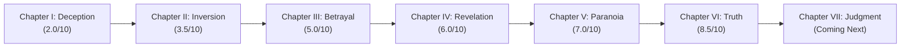
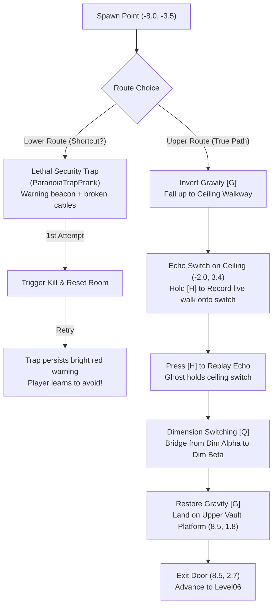
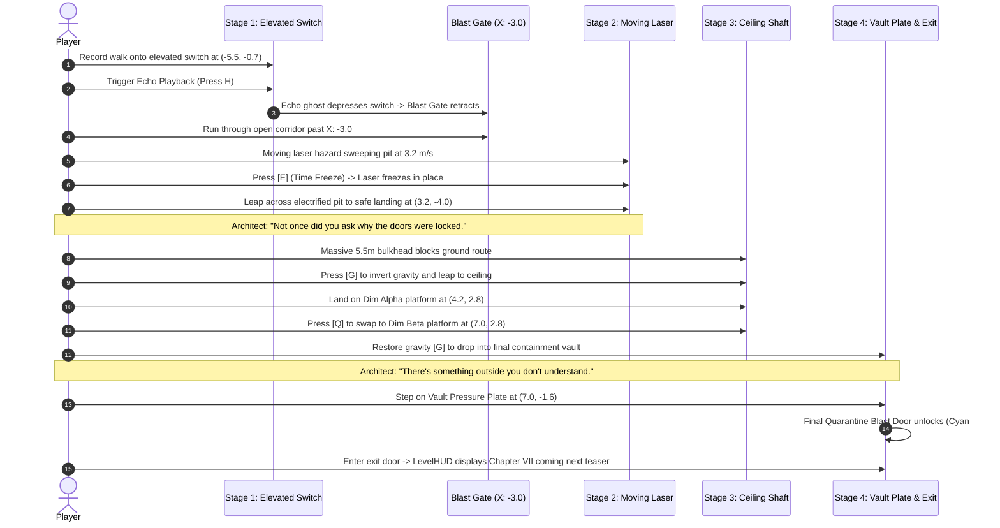

# GLITCHVERSE: ECHO PROTOCOL
## PHASE 09 — CHAPTER V: PARANOIA + CHAPTER VI: TRUTH
### COMPLETION REPORT

**Project:** `/Users/shlokmukane/BOSSFIGHT-`  
**Engine:** Unity 6000.6.7f1 / URP 2D  
**Branch:** `feature/shlok-core`  
**Git Milestone Commit:** `a5a23ae`  
**Previous Baseline:** `50669b3`  

---

### EXECUTIVE SUMMARY

GLITCHVERSE: ECHO PROTOCOL has been successfully expanded from a 4-chapter game into a complete, 6-chapter campaign with escalating difficulty and psychological tension. Chapter V (Paranoia) introduces deceptive branching pathways with learnable ragebait security traps, inverted ceiling traversal, and dimension-switching bridges. Chapter VI (Truth) culminates in a high-security quarantine core requiring multi-stage mastery of all three reality powers alongside timeline echo synchronization, terminating in the temporary teaser sequence for Chapter VII.

All existing gameplay mechanics, Phase 07/07.5 pranks, Phase 08 atmospheric lighting, and the Chapter III Y/N interrogation hotfix remain completely intact.

---

### SIX-CHAPTER PROGRESSION ARCHITECTURE

The campaign progression now flows seamlessly through all six chambers:



#### Build Settings Scene Index

| Build Index | Scene Asset Path | Chamber Name | Next Destination | Is Final |
|:---:|:---|:---|:---:|:---:|
| **0** | `Assets/_Game/Scenes/Levels/Level01.unity` | CHAPTER I — DECEPTION | Level02 | No |
| **1** | `Assets/_Game/Scenes/Levels/Level02.unity` | CHAPTER II — INVERSION | Level03 | No |
| **2** | `Assets/_Game/Scenes/Levels/Level03.unity` | CHAPTER III — BETRAYAL | Level04 | No |
| **3** | `Assets/_Game/Scenes/Levels/Level04.unity` | CHAPTER IV — REVELATION | Level05 | No |
| **4** | `Assets/_Game/Scenes/Levels/Level05.unity` | CHAPTER V — PARANOIA | Level06 | No |
| **5** | `Assets/_Game/Scenes/Levels/Level06.unity` | CHAPTER VI — TRUTH | *End of Content* | **Yes** |

---

### CHAPTER V — PARANOIA: ARCHITECTURE & SOLUTION

- **Target Difficulty:** 7/10
- **Intro Banner:** `CHAPTER V — PARANOIA`  
  *Subtitle:* `"Trust nothing. Especially yourself."`
- **Atmosphere:** Cold surveillance violet (`Color(0.12, 0.05, 0.18)`), surveillance motes particle emitter, Perlin-jitter surveillance spotlight, overhead surveillance monitors.
- **Architect Dialogue:** *"You still think choosing is the same as being free?"*

#### Level Layout & Puzzle Mechanics



#### Exact Chapter V Solution Walkthrough

1. **Observe Clues:** Do not take the floor shortcut to the right. Notice the broken cables, emergency strobe beacon, and hazard striping on the ground.
2. **Invert Gravity:** Press **[G]** at spawn. Gravity inverts, and the player falls up onto the overhead steel beam walkway at $Y = 3.8$.
3. **Record Echo on Switch:** Press **[H]** to initiate Echo recording. Walk right along the ceiling walkway to the inverted `EchoSwitch_Ceiling` at $X = -2.0, Y = 3.4$. Stand on the switch for 2 seconds. Press **[H]** to stop recording.
4. **Trigger Echo Replay:** Press **[H]** to replay the recorded timeline. The translucent cyan ghost repeats the walk and remains resting on the ceiling switch, depressing it and unlocking the upper blast door.
5. **Traverse Dimension Bridge:** Jump right from the walkway onto the cyan **Dimension Alpha Platform** at $(1.5, 3.0)$.
6. **Swap Reality Dimension:** Press **[Q]** to switch to **Dimension Beta**. The magenta platform at $(4.8, 3.2)$ solidifies beneath the player.
7. **Drop to Exit:** Jump toward the elevated landing at $(8.5, 1.8)$ and press **[G]** to restore normal gravity. Walk into the unlocked `ExitDoor` at $(8.5, 2.7)$ to clear the chamber and transition into Chapter VI.

---

### CHAPTER VI — TRUTH: ARCHITECTURE & SOLUTION

- **Target Difficulty:** 8.5/10
- **Intro Banner:** `CHAPTER VI — TRUTH`  
  *Subtitle:* `"Some doors were locked for a reason."`
- **Atmosphere:** Sealed quarantine emergency crimson (`Color(0.20, 0.04, 0.06)`), dormant containment reactor core, sterile white floodlights, brutalist pilasters, quarantine decals.
- **Narrative Progression:** The Architect ceases sarcastic mockery, adopting chilling, serious delivery:
  - *Stage 1 Entry:* `"You've spent six chambers proving you can escape."`
  - *Stage 2 Hazard Crossing:* `"Not once did you ask why the doors were locked."`
  - *Stage 3 Vault Breach:* `"There's something outside you don't understand."`
- **Final Sequence:** LevelHUD displays the temporary end-of-content screen:  
  **`CONTAINMENT CORE UNLOCKED`**  
  **`CHAPTER VII — JUDGMENT: COMING NEXT`**

#### Exact Chapter VI Multi-Stage Solution Walkthrough



---

### VISUAL DOCUMENTATION: ALL SIX CHAPTERS

The industrial-horror environment progression captured directly from the game view:

````carousel

<!-- slide -->

<!-- slide -->

<!-- slide -->

<!-- slide -->

<!-- slide -->

````

---

### VERIFICATION & AUTOMATED TEST RESULTS

#### Phase081RegressionRepairValidator Execution Output

```
=== PHASE 08.1 PROGRESSION & DIALOGUE REPAIR VALIDATION ===

--- 1. Build Settings Verification ---
[PASS] Level01 is enabled at Build Index 0.

--- 2. Scene Field & Narrative Wiring Verification ---
[PASS] Level01: chamberNumber = 1
[PASS] Level01: nextSceneName = 'Level02'
[PASS] Level01: isFinalLevel = False
[PASS] Level01: SubtitleText='SubtitleContentText', Banner='ArchitectSubtitleBanner', Flash='EmergencyFlashOverlay' wired.
[PASS] Level 01: FakeExitPrank and RealExitDoor_PlatformA confirmed.
[PASS] Level02: chamberNumber = 2
[PASS] Level02: nextSceneName = 'Level03'
[PASS] Level02: isFinalLevel = False
[PASS] Level02: SubtitleText='SubtitleContentText', Banner='ArchitectSubtitleBanner', Flash='EmergencyFlashOverlay' wired.
[PASS] Level 02: FakeEmergencyPrank and CollapsingFloor confirmed.
[PASS] Level03: chamberNumber = 3
[PASS] Level03: nextSceneName = 'Level04'
[PASS] Level03: isFinalLevel = False
[PASS] Level03: SubtitleText='SubtitleContentText', Banner='ArchitectSubtitleBanner', Flash='EmergencyFlashOverlay' wired.
[PASS] Level 03: ImpossibleQuestionPrank confirmed.
[PASS] Level04: chamberNumber = 4
[PASS] Level04: nextSceneName = 'Level05'
[PASS] Level04: isFinalLevel = False
[PASS] Level04: SubtitleText='SubtitleContentText', Banner='ArchitectSubtitleBanner', Flash='EmergencyFlashOverlay' wired.
[PASS] Level 04: FakeCheckpointPrank confirmed.
[PASS] Level05: chamberNumber = 5
[PASS] Level05: nextSceneName = 'Level06'
[PASS] Level05: isFinalLevel = False
[PASS] Level05: SubtitleText='SubtitleContentText', Banner='ArchitectSubtitleBanner', Flash='EmergencyFlashOverlay' wired.
[PASS] Level 05: ParanoiaTrapPrank, EchoSwitch, and 2 Dimension Platforms confirmed.
[PASS] Level06: chamberNumber = 6
[PASS] Level06: nextSceneName = ''
[PASS] Level06: isFinalLevel = True
[PASS] Level06: SubtitleText='SubtitleContentText', Banner='ArchitectSubtitleBanner', Flash='EmergencyFlashOverlay' wired.
[PASS] Level 06: TruthChamberTriggers, FreezableHazard, EchoSwitch, and VaultPlate confirmed.

--- 3. Chapter III Interrogation & Fake-Success Trap Validation ---
[PASS] Interrogation triggered: Player locked and awaiting answer.
[PASS] Prompt format verified: Y/N options visible, A/D movement keys excluded.
[PASS] Fake Success Step 1: 'ANSWER ACCEPTED.' displayed in green.
[PASS] Fake Success Step 2: 'YOU MAY PROCEED.' displayed.
[PASS] Fake Success Step 3: Interrogation prompt hidden, 'I LIED.' betrayal line executed.
[PASS] HasExperiencedQuestion persists: Interrogation disarmed for session.
[PASS] Level03 progression target preserved: 'Level04'.

=======================================================
OVERALL VALIDATION RESULT: PASSED
=======================================================
```

#### Standalone macOS Player Build Evidence

- **Build Target:** `StandaloneOSX`
- **Output:** `Builds/macOS/GlitchVerse.app`
- **Total Scenes Built:** 6 (Level01 through Level06)
- **Build Duration:** 10.7 seconds
- **Compilation Errors:** 0
- **Build Result:** `Succeeded`

---

### IMPLEMENTED & MODIFIED CODEFILES

1. [ChamberBuilder.cs](file:///Users/shlokmukane/BOSSFIGHT-/Assets/_Game/Editor/ChamberBuilder.cs): Automated generation and construction methods for `Level05.unity` and `Level06.unity`, wiring puzzles, atmospheric lighting, and scene registration.
2. [LevelDirector.cs](file:///Users/shlokmukane/BOSSFIGHT-/Assets/_Game/Scripts/Core/LevelDirector.cs): Configured 6-chamber linear progression: Level04 → Level05 → Level06 (isFinalLevel = true).
3. [ChapterIntroController.cs](file:///Users/shlokmukane/BOSSFIGHT-/Assets/_Game/Scripts/Narrative/ChapterIntroController.cs): Implemented horror black overlay sequences for Chapter V ("PARANOIA") and Chapter VI ("TRUTH").
4. [ArchitectTriggers.cs](file:///Users/shlokmukane/BOSSFIGHT-/Assets/_Game/Scripts/Narrative/ArchitectTriggers.cs): Added introductory dialogues for Chambers 5 and 6.
5. [ParanoiaTrapPrank.cs](file:///Users/shlokmukane/BOSSFIGHT-/Assets/_Game/Scripts/Narrative/ParanoiaTrapPrank.cs): Ragebait fake shortcut trap controller with session persistence and clear warning cues on retry.
6. [TruthChamberTriggers.cs](file:///Users/shlokmukane/BOSSFIGHT-/Assets/_Game/Scripts/Narrative/TruthChamberTriggers.cs): Controls Stage 1 blast gate retraction via EchoSwitch synchronization and Stage 2/3 chilling narrative progression lines.
7. [LevelHUD.cs](file:///Users/shlokmukane/BOSSFIGHT-/Assets/_Game/UI/LevelHUD.cs): Temporary end-of-content screen with "CONTAINMENT CORE UNLOCKED" / "CHAPTER VII — JUDGMENT: COMING NEXT" formatting.
8. [AtmosphericParticleEmitter.cs](file:///Users/shlokmukane/BOSSFIGHT-/Assets/_Game/Scripts/Atmosphere/AtmosphericParticleEmitter.cs): Added `SurveillanceMotes` and `QuarantineStatic` presets.
9. [FlickeringLight2D.cs](file:///Users/shlokmukane/BOSSFIGHT-/Assets/_Game/Scripts/Atmosphere/FlickeringLight2D.cs): Added `SurveillanceGlow` and `QuarantineAlarm` lighting presets.
10. [EditorBuildSettings.asset](file:///Users/shlokmukane/BOSSFIGHT-/ProjectSettings/EditorBuildSettings.asset): Added Level05 and Level06 into active build list.

---

### KNOWN LIMITATIONS & FUTURE ROADMAP

- **Chapter VII Boss Encounter:** Deferred to subsequent phases in strict adherence to directive constraints.
- **Character Sprite Redesign & Full UI Overhaul:** Slated for Phase 11.
- **Reference Image Cinematic Direction:** Reserved for the comprehensive visual redesign milestone.
