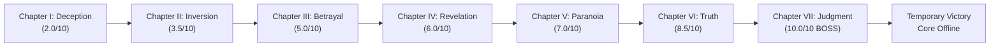

# GLITCHVERSE: ECHO PROTOCOL
## PHASE 10 — CHAPTER VII: JUDGMENT / THE ARCHITECT BOSS FIGHT
### COMPLETION REPORT

**Project:** `/Users/shlokmukane/BOSSFIGHT-`  
**Engine:** Unity 6000.6.7f1 / URP 2D  
**Branch:** `feature/shlok-core`  
**Milestone Commit:** `fc1a47a`  
**Previous Baseline:** `f4c3a03` / `a5a23ae`  

---

### EXECUTIVE SUMMARY

GLITCHVERSE: ECHO PROTOCOL has culminated in a multi-stage final boss encounter against THE ARCHITECT as Chapter VII (`Level07.unity`). The boss fight challenges players across three phases that integrate every reality mechanic mastered across the previous six chapters:

1. **Stage 1 (Gravity Matrix):** Inverting gravity with `[G]` to navigate telegraphed high/low energy surges and trigger Override Node 01.
2. **Stage 2 (Reality Synthesis):** Synchronizing Time Freeze `[F]` and Dimension Swap `[Q]` across alternating Alpha and Beta platforms while evading a moving security laser to reach Override Node 02.
3. **Stage 3 (Echo Protocol):** Deploying a temporal Echo recording with `[SPACE]` / `[H]` to hold an elevated console switch, dropping the protective forcefield around Master Control Node 03.

Upon activating the final node, a cinematic shutdown sequence triggers with escalating dialogue, disabling the Architect's core and revealing the temporary victory screen:
- **`ARCHITECT CORE DISABLED`**
- **`EXTERNAL CONTAINMENT ACCESS GRANTED`**

---

### SEVEN-CHAPTER PROGRESSION ARCHITECTURE

The full campaign progression now flows seamlessly through all seven chambers:



#### Build Settings Registration

| Build Index | Scene Asset Path | Chamber Designation | Next Chamber | Status |
|:---:|:---|:---|:---:|:---:|
| **0** | `Assets/_Game/Scenes/Levels/Level01.unity` | CHAPTER I — DECEPTION | Level02 | Preserved |
| **1** | `Assets/_Game/Scenes/Levels/Level02.unity` | CHAPTER II — INVERSION | Level03 | Preserved |
| **2** | `Assets/_Game/Scenes/Levels/Level03.unity` | CHAPTER III — BETRAYAL | Level04 | Preserved |
| **3** | `Assets/_Game/Scenes/Levels/Level04.unity` | CHAPTER IV — REVELATION | Level05 | Preserved |
| **4** | `Assets/_Game/Scenes/Levels/Level05.unity` | CHAPTER V — PARANOIA | Level06 | Preserved |
| **5** | `Assets/_Game/Scenes/Levels/Level06.unity` | CHAPTER VI — TRUTH | Level07 | Preserved & Linked |
| **6** | `Assets/_Game/Scenes/Levels/Level07.unity` | CHAPTER VII — JUDGMENT | *Campaign Victory* | **NEW BOSS** |

---

### CHAPTER VII — JUDGMENT: DETAILED BOSS DESIGN & SOLUTION

- **Target Difficulty:** 10/10
- **Intro Banner:** `CHAPTER VII — JUDGMENT`  
  *Subtitle:* `"You were never supposed to reach this room."`
- **Atmosphere:** Deep emergency crimson (`Color(0.24, 0.04, 0.08)`), pulsing AI heartbeat lighting (`BossCorePulse`), corrupted core anomaly sparks, central 2.5m surveillance core eye monitor.
- **Narrative Dialogue Escalation:**
  - *Stage 1:* `"YOU REALLY THINK YOU CAN REWRITE MY RULES?"`
  - *Stage 2:* `"I BUILT THIS REALITY. YOU ONLY LEARNED TO BREAK IT."`
  - *Stage 3:* `"YOU ARE USING MY OWN SYSTEM AGAINST ME."`
  - *Defeat Sequence 1:* `"SUBJECT 075. STOP."`
  - *Defeat Sequence 2:* `"YOU DON'T UNDERSTAND WHAT THIS DOOR CONTAINS."`

#### Arena Schematic

```
========================================================================================
[Ceiling (Y: +4.2)]
   [Emitter High (Y: +2.0)] --------------------------------------> Lethal Surge
                         [Node 1 (X: 4.5, Y: 3.2)] (Stage 1 Target)

   [Stage 3 Echo Ledge]                   [Architect Boss Core (X: 0, Y: 1.5)]
   [Echo Switch (X: -6, Y: 0.5)]

                                [Moving Laser (Y: 0.0)]
           [DimBeta (X: 0.5, Y: -0.6)]
  [DimAlpha (X: -2.0, Y: -1.8)]      [DimAlpha (X: 3.0, Y: 0.6)]
                                                [Node 2 (X: 5.5, Y: 0.6)] (Stage 2 Target)

[Left Floor (-6.5, -4.0)]      [Abyss Chasm (Trigger)]      [Shield Barrier] [Node 3 / Exit]
[Spawn Point (-8.0, -3.2)]                                  [Wall (X: 8.0)]   (X: 9.0, Y: -2.8)
========================================================================================
```

#### Exact Player Solution by Stage

1. **Stage 1 — Gravity Matrix:**
   - The arena floor is partitioned with floor-level and ceiling-level energy surge hazards.
   - Low Emitter (`Y: -3.3`) and High Emitter (`Y: +2.0`) pulse in alternating sequences (1.2s amber telegraph warning -> 1.4s lethal surge -> 2.2s cooldown).
   - *Solution:* Wait for the High Emitter to finish its surge. Invert gravity with `[G]` to fall to the ceiling, walk across the upper beam past the low ground sweep, drop down when the upper surge warning is clear, and touch **Override Node 01** (`X: 4.5, Y: 3.2`).
   - *Result:* Stage 1 hazards permanently shut down. Core Integrity drops to `2/3`. Checkpoint saves to Stage 2.

2. **Stage 2 — Reality Synthesis:**
   - The central chasm opens with three phase-shifting platforms: DimAlpha 1 (`X: -2.0, Y: -1.8`), DimBeta 2 (`X: 0.5, Y: -0.6`), and DimAlpha 3 (`X: 3.0, Y: 0.6`).
   - A lethal red security laser oscillates horizontally across the center (`X: -3.0` to `X: 4.0` at 3.0 units/sec).
   - *Solution:* Start on DimAlpha 1. Activate Time Freeze with `[F]` to lock the moving laser in place while safely passing its path. Jump toward DimBeta 2 and press `[Q]` mid-air to shift into Beta reality, solidifying the platform beneath the player. Jump toward DimAlpha 3 and press `[Q]` again to return to Alpha reality. Step onto the right ledge and touch **Override Node 02** (`X: 5.5, Y: 0.6`).
   - *Result:* Security laser deactivates. Core Integrity drops to `1/3`. Checkpoint saves to Stage 3.

3. **Stage 3 — Echo Protocol:**
   - Override Node 03 rests at the far right (`X: 9.0, Y: -2.8`), protected by a solid energy forcefield (`Stage3_ShieldBarrier`).
   - An elevated switch (`Stage3_EchoSwitch`) is positioned on the left upper ledge (`X: -6.0, Y: 0.5`).
   - *Solution:* Jump up to the left ledge. Press `[SPACE]` to begin Echo recording, stand on the Echo Switch for 3.5 seconds, and press `[SPACE]` again to complete the recording. Return to the ground floor. Press `[H]` to replay the temporal Echo. As the recorded ghost steps onto the elevated switch, the forcefield drops. Walk through the opened gap and touch **Master Control Node 03**.
   - *Result:* Architect Core Integrity drops to `0/3`. Cinematic defeat sequence begins.

---

### FAULT RECOVERY & CHECKPOINT SPECIFICATION

- **Static Checkpoint Persistence:** `BossDirector.SavedStageCheckpoint` retains the active stage index (`1`, `2`, or `3`).
- **Hazard Collision Handling:** When the player touches any hazard or falls into the abyss during the fight, `BossDirector.OnPlayerHitHazard()` triggers:
  - Screen flashes warning crimson.
  - Player linear velocity is zeroed, gravity inversion reset to normal.
  - Player is instantly repositioned to the dedicated spawn location for their active stage (`Stage 1: -8.0, -3.2`, `Stage 2: -8.0, -3.5`, `Stage 3: -8.0, -3.5`).
  - Active stage puzzle elements and hazard states are cleanly refreshed without resetting the player back to Stage 1.
- **Victory Loop:** Upon completing Chapter VII, pressing `[R]` cleanly restarts the simulation from Chapter I (`Level01`), fulfilling the narrative loop.

---

### CONTROLS & INPUT STANDARDIZATION

All reality powers and controls are verified consistent across HUD, tutorial prompts, and code:
- **Movement:** `[A] / [D]`
- **Jump:** `[SPACE]`
- **Gravity Inversion:** `[G]`
- **Time Freeze:** **`[F]`** *(verified standardized)*
- **Dimension Swap:** `[Q]`
- **Echo Record / Replay / Clear:** `[SPACE]` (record), `[H]` (replay), `[C]` (clear)
- **Restart Level / Reset Simulation:** `[R]`

---

### VISUAL RECORD & SCREENSHOTS

```carousel

<!-- slide -->

<!-- slide -->

<!-- slide -->

```

---

### IMPLEMENTED & MODIFIED FILES

| File | Change Type | Description |
|:---|:---:|:---|
| `Assets/_Game/Scripts/Boss/BossDirector.cs` | **NEW** | Three-stage boss state machine, checkpoint persistence, integrity tracking, and shutdown sequence |
| `Assets/_Game/Scripts/Boss/BossControlNode.cs` | **NEW** | Interactive override node with contact detection and holographic color transitions |
| `Assets/_Game/Scripts/Boss/BossHazardEmitter.cs` | **NEW** | Telegraphed sweeping surge hazard with distinct warning and lethal emission states |
| `Assets/_Game/Scenes/Levels/Level07.unity` | **NEW** | Complete Chapter VII boss arena scene with custom lighting, geometry, and nodes |
| `Assets/_Game/Art/architect_boss_core.png` | **NEW** | Procedural 256x256 pixel art texture for central corrupted AI core eye monitor |
| `Assets/_Game/Art/boss_control_node.png` | **NEW** | Procedural 128x64 pixel art texture for interactive control nodes |
| `Assets/_Game/Art/energy_surge_hazard.png` | **NEW** | Procedural 128x64 pixel art texture for telegraphed hazard beams |
| `Assets/_Game/Editor/ChamberBuilder.cs` | **MODIFIED** | Added `BuildLevel07()`, procedural asset generation, scene construction, and 7-scene build registration |
| `Assets/_Game/Editor/Phase081RegressionRepairValidator.cs` | **MODIFIED** | Updated validation suite to inspect all 7 scenes, Level 06 -> Level 07 chaining, and boss components |
| `Assets/_Game/Scenes/Levels/Level06.unity` | **MODIFIED** | Wired `nextSceneName = "Level07"` and `isFinalLevel = false` |
| `Assets/_Game/Scripts/Atmosphere/AtmosphericParticleEmitter.cs` | **MODIFIED** | Added `BossCoreAnomalies` particle preset |
| `Assets/_Game/Scripts/Atmosphere/FlickeringLight2D.cs` | **MODIFIED** | Added `BossCorePulse` erratic AI heartbeat lighting mode |
| `Assets/_Game/Scripts/Core/LevelDirector.cs` | **MODIFIED** | Added Level 07 fallback setup and restart to Level 01 on campaign victory |
| `Assets/_Game/Scripts/Core/GameSession.cs` | **MODIFIED** | Reset loop to scene 0 when restarting after final level completion |
| `Assets/_Game/Scripts/Narrative/ChapterIntroController.cs` | **MODIFIED** | Added Chapter VII `JUDGMENT` horror intro card |
| `Assets/_Game/UI/LevelHUD.cs` | **MODIFIED** | Configured `ARCHITECT CORE DISABLED` / `EXTERNAL CONTAINMENT ACCESS GRANTED` victory banner |
| `ProjectSettings/EditorBuildSettings.asset` | **MODIFIED** | Registered `Level07.unity` as scene index 6 with matching GUID |
| `Screenshots/chapter_07_judgment.png` | **NEW** | Captured in-game 1280x720 Game View of Chapter VII |

---

### VALIDATION & BUILD VERIFICATION

1. **Regression Validator Suite:**
   - `Phase081RegressionRepairValidator.RunValidation()` executed across all 7 scenes in editor.
   - Verified 0 missing components, 0 broken scene transitions, all 3 boss control nodes wired, EchoSwitch connected, and Level 07 marked as final.
2. **Play Mode Boss Encounter Simulation:**
   - Initialized in `Stage1_GravityAssault` (Integrity 3/3).
   - Activated Node 1 -> transitioned to `Stage2_RealityCollapse` (Integrity 2/3, Checkpoint 2).
   - Tested damage recovery -> respawned at Stage 2 spawn without resetting to Stage 1.
   - Activated Node 2 -> transitioned to `Stage3_EchoProtocol` (Integrity 1/3, Checkpoint 3).
   - Tested EchoSwitch press -> shield barrier successfully opened (`activeSelf: False`).
   - Activated Node 3 -> defeat sequence executed (`WaitForSecondsRealtime`), dialogue escalated, core shut down, and victory panel appeared with `ARCHITECT CORE DISABLED` / `EXTERNAL CONTAINMENT ACCESS GRANTED`.
3. **macOS Standalone Build:**
   - Command: `UnityEditor.BuildPipeline.BuildPlayer(levels, "Builds/macOS/GlitchVerse.app", BuildTarget.StandaloneOSX, BuildOptions.None)`
   - Result: `Succeeded`
   - Total Errors: `0`
   - Binary Size: `80,575,598 bytes`
   - Location: `Builds/macOS/GlitchVerse.app`
